# PETSTAY / Petbnb — Documentação Completa do Projeto

> Marketplace estilo Airbnb para hospedagem e daycare de pets.  
> Documento para apresentação e implantação. Versão alinhada ao código do repositório.

| Campo | Valor |
|-------|--------|
| **Nome do produto** | PETSTAY (marca na UI: **Petbnb**) |
| **Status atual** | Fase 0 — Protótipo navegável (SPA + mocks) |
| **Stack** | React 19 · Vite 8 · TypeScript · Tailwind · Shadcn/Radix · React Router 7 |
| **Repositório** | `petstay-airbnb-para-pets` |
| **Porta de desenvolvimento** | `http://localhost:8080` |

---

## Sumário

1. [Sumário executivo](#1-sumário-executivo)
2. [Problema e proposta de valor](#2-problema-e-proposta-de-valor)
3. [Personas e papéis](#3-personas-e-papéis)
4. [Arquitetura atual](#4-arquitetura-atual)
5. [Modelo de domínio](#5-modelo-de-domínio)
6. [Mapa de telas e screenshots](#6-mapa-de-telas-e-screenshots)
7. [Jornadas do usuário](#7-jornadas-do-usuário)
8. [Funcionalidades: implementado vs simulado](#8-funcionalidades-implementado-vs-simulado)
9. [Fases do projeto (roadmap)](#9-fases-do-projeto-roadmap)
10. [Implantação](#10-implantação)
11. [Requisitos não funcionais](#11-requisitos-não-funcionais)
12. [Riscos e mitigações](#12-riscos-e-mitigações)
13. [Anexos](#13-anexos)

---

## 1. Sumário executivo

O **PETSTAY (Petbnb)** conecta **tutores** e **anfitriões** para hospedagem domiciliar, daycare e casas pet-friendly, com foco em segurança animal: perfil de saúde/comportamento do pet, regras de aceitação, Instant Book, chat, diário de bordo, check-in/out com caução e avaliações *double-blind*.

**Estado do código:** frontend SPA completo em UX, com estado em memória (`DataContext` + `mockData`). Não há backend, autenticação real, banco de dados nem gateway de pagamento. Ideal para **demo de produto e validação de UX**; as Fases 1–4 descrevem o caminho até produção.

---

## 2. Problema e proposta de valor

### Problema

- Opções tradicionais (hotéis/creches) são caras e pouco transparentes.
- Pouca informação sobre compatibilidade comportamental e ambiente seguro (telas, quintal, outros animais).
- Comunicação fragmentada entre tutor e cuidador durante a estadia.
- Baixa confiança em avaliações unilaterais e ausência de trilha de cuidado (fotos, alimentação, medicação).

### Proposta

| Capacidade | Benefício |
|------------|-----------|
| Perfil completo do pet | Saúde, vacinas, comportamento, emergência |
| Anúncios com regras pet | Tamanhos aceitos, cercas, telas, Instant Book |
| Reserva com taxas claras | Diária, limpeza, taxa de serviço, caução |
| Chat + diário de bordo | Transparência durante a estadia |
| Check-in / check-out | Checklist e liberação de caução |
| Reviews double-blind | Confiança mútua tutor ↔ host |

---

## 3. Personas e papéis

Definidos em `src/types/index.ts` como `UserRole`:

| Papel | Responsabilidades | Status no código |
|-------|-------------------|------------------|
| **Tutor** | Cadastrar pets, buscar, reservar, chat, reviews | UI + mock |
| **Host** | Anúncios, aprovações, calendário, diário, check-in/out | UI + mock |
| **Admin** | Moderação, disputas, verificação | Apenas no tipo — **sem tela** |

Extras do modelo: `isHostVerified`, `isSuperHost`, rating e contagem de reviews.

A troca de papel na demo ocorre pelo **banner de simulação** no `Layout` (não é autenticação real).

---

## 4. Arquitetura atual

```
┌─────────────────────────────────────────┐
│  Browser (SPA React Router)             │
│  pages/ + components/ + ui/ (Shadcn)    │
└─────────────────┬───────────────────────┘
                  │
                  ▼
┌─────────────────────────────────────────┐
│  DataContext (React Context + useState) │
│  actions: pets, bookings, chat, reviews │
└─────────────────┬───────────────────────┘
                  │
                  ▼
┌─────────────────────────────────────────┐
│  mockData.ts (seed em memória)          │
│  Refresh do browser → perde alterações  │
└─────────────────────────────────────────┘
```

### Estrutura de pastas (relevante)

```
petstay-airbnb-para-pets/
├── docs/
│   ├── PETSTAY-Documentacao.md    ← este arquivo
│   └── screenshots/               ← capturas das telas
├── src/
│   ├── App.tsx                    ← rotas
│   ├── pages/                     ← telas
│   ├── components/                ← Layout, SearchBar, ListingCard, ui/
│   ├── context/DataContext.tsx
│   ├── data/mockData.ts
│   ├── types/index.ts
│   └── lib/utils.ts
├── package.json
├── vite.config.ts                 ← porta 8080
└── README.md
```

### Stack tecnológica

| Camada | Tecnologia |
|--------|------------|
| UI | React 19, TypeScript |
| Build | Vite 8 |
| Roteamento | react-router-dom v7 |
| Estilo | Tailwind CSS 3, tema verde (#22C55E), Plus Jakarta Sans |
| Componentes | Shadcn UI + Radix |
| Forms / validação | react-hook-form, Zod (disponíveis; várias telas usam `useState`) |
| Gráficos | Recharts |
| Qualidade | Oxlint, Oxfmt |
| Package manager | pnpm |

---

## 5. Modelo de domínio

Fontes: `src/types/index.ts` e seed em `src/data/mockData.ts`.

### Entidades principais

| Entidade | Campos-chave |
|----------|----------------|
| **User** | id, name, email, avatar, role, bio, phone, flags de host |
| **Pet** | espécie, porte, vacinas, comportamento, emergência, foto |
| **Listing** | tipo de espaço, preço, taxas, amenities, regras, Instant Book, calendário bloqueado |
| **Booking** | datas, totais, status, inspeções check-in/out |
| **DailyLogEntry** | humor, alimentação, medicação, passeios, foto |
| **ChatMessage** | tutor/host, texto, opcionalmente entrada de diário |
| **DoubleBlindReview** | notas tutor→host e host→tutor, revelação mútua |

### Status de reserva

`pending` → `confirmed` → `in_progress` → `completed` (ou `cancelled`)

### Tipos de espaço

- Hospedagem domiciliar  
- Daycare (creche diurna)  
- Casa inteira pet-friendly  

### Diagrama conceitual (ER simplificado)

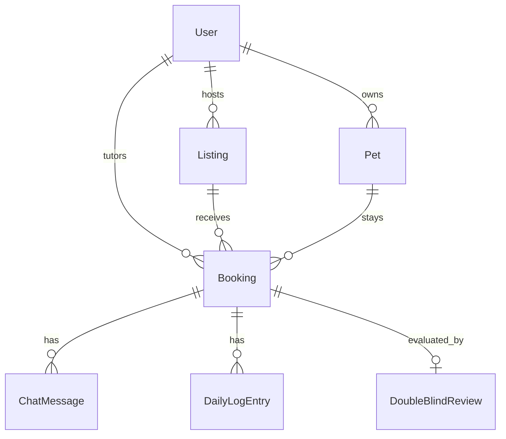

---

## 6. Mapa de telas e screenshots

Rotas definidas em `src/App.tsx`. Imagens em `docs/screenshots/`.

> **Como regenerar capturas:** com o app em `http://localhost:8080`, percorra as rotas abaixo e salve PNGs com os nomes indicados. Use o banner de simulação para alternar tutor ↔ host.

### 6.1 Home / Explorar — `/`

**Arquivo:** `src/pages/Index.tsx`  
**Screenshot:** `screenshots/01-home.png`

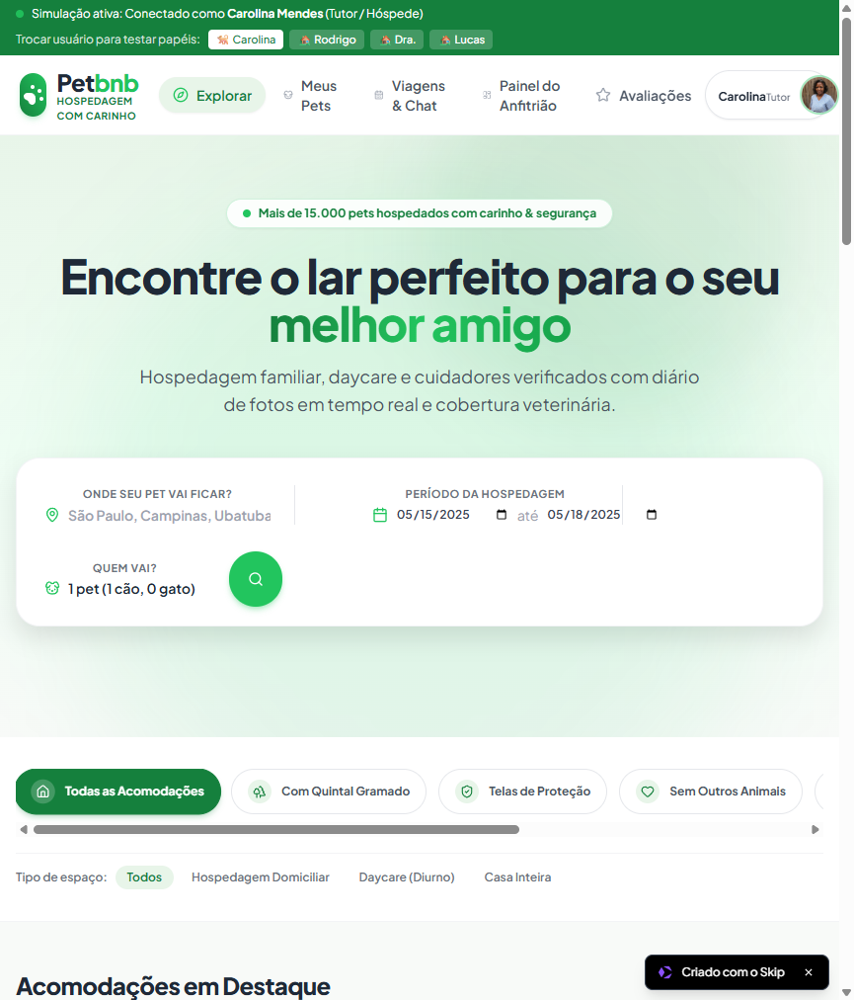

*Hero, busca (local, datas, cães/gatos), categorias pet e grid de anúncios.*

---

### 6.2 Detalhe do anúncio — `/listings/:id`

**Arquivo:** `src/pages/ListingDetails.tsx`  
**Exemplo:** `/listings/list-1`  
**Screenshot:** `screenshots/02-listing-details.png`

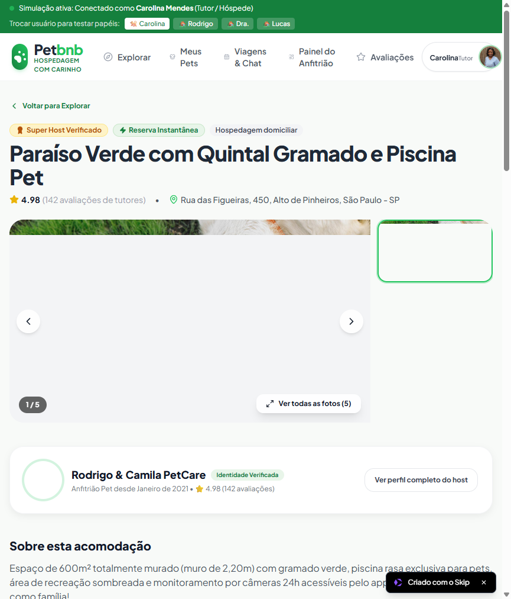

*Galeria, descrição, regras de aceitação, amenities, host e calculadora de preço / Instant Book.*

---

### 6.3 Meus Pets — `/pets`

**Arquivo:** `src/pages/PetsList.tsx`  
**Screenshot:** `screenshots/03-pets-list.png`

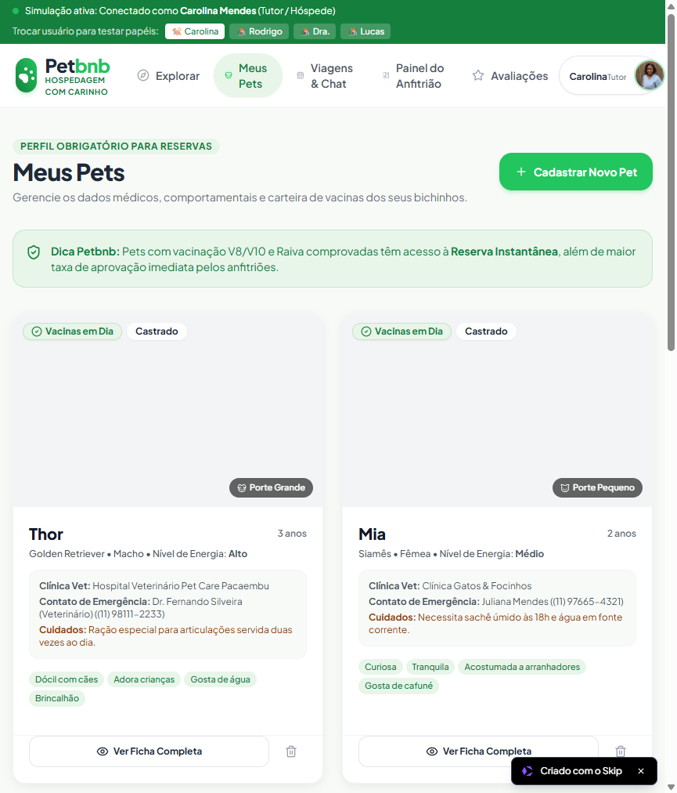

*Listagem dos pets do tutor com acesso a detalhe e exclusão.*

---

### 6.4 Cadastro de pet — `/pets/novo`

**Arquivo:** `src/pages/NewPetForm.tsx`  
**Screenshot:** `screenshots/04-new-pet.png`

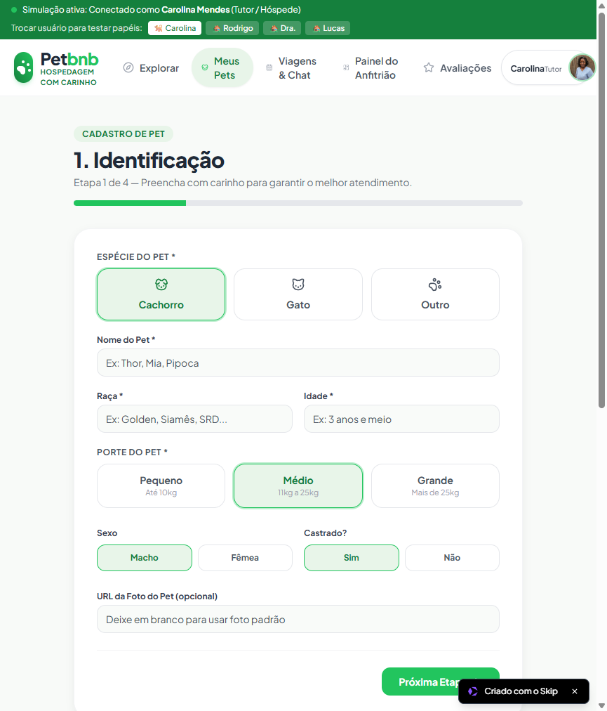

*Wizard em 4 passos: identificação, saúde/vacinas, comportamento, emergência. Upload de carteira é simulado.*

---

### 6.5 Detalhe do pet — `/pets/:id`

**Arquivo:** `src/pages/PetDetails.tsx`  
**Exemplo:** `/pets/pet-1`  
**Screenshot:** `screenshots/05-pet-details.png`

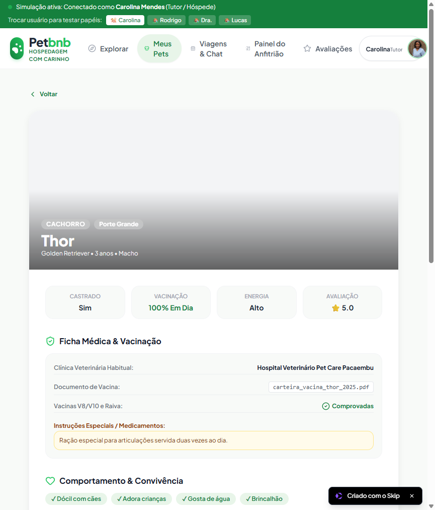

*Perfil completo: saúde, tags de comportamento, contato de emergência.*

---

### 6.6 Checkout — `/checkout/:id`

**Arquivo:** `src/pages/Checkout.tsx`  
**Exemplo:** `/checkout/list-1`  
**Screenshot:** `screenshots/06-checkout.png`

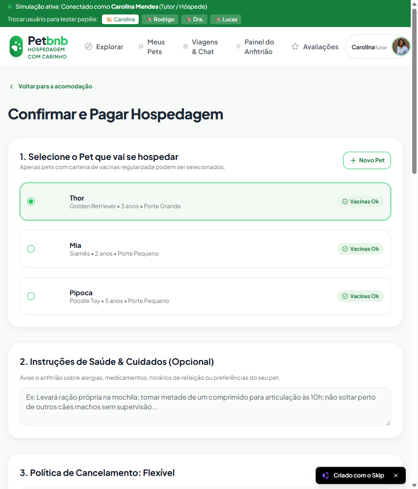

*Seleção de pet, instruções de saúde, política de cancelamento e pagamento mock (cartão local).*

---

### 6.7 Painel do anfitrião — `/host`

**Arquivo:** `src/pages/HostDashboard.tsx`  
**Screenshot:** `screenshots/07-host-dashboard.png`

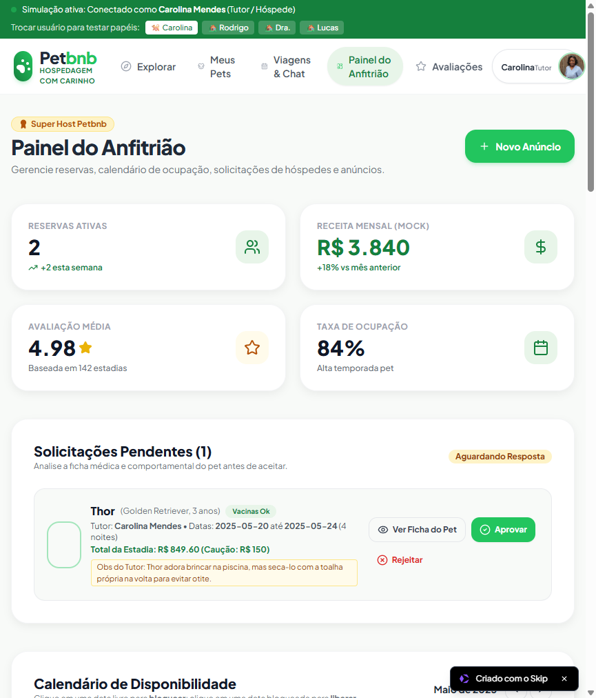

*Aprovar/recusar reservas, calendário bloqueável, pausar anúncio, criar listing, receita mensal mock.*

---

### 6.8 Viagens & Chat — `/reservations`

**Arquivo:** `src/pages/ReservationsChat.tsx`  
**Screenshot:** `screenshots/08-reservations-chat.png`

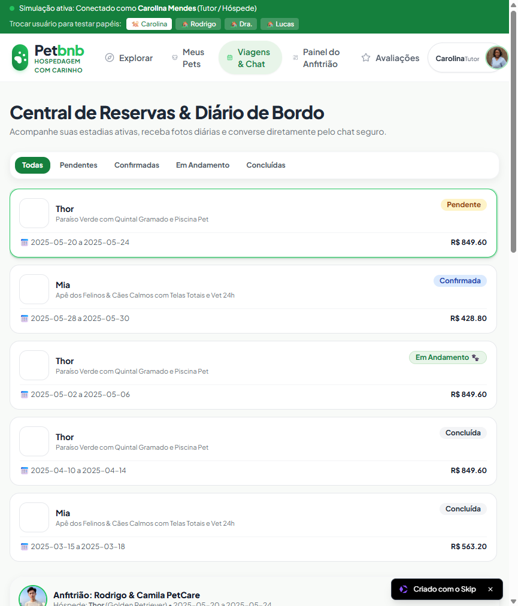

*Reservas por status, chat, diário de bordo, check-in com checklist e check-out com caução.*

---

### 6.9 Avaliações — `/reviews`

**Arquivo:** `src/pages/ReviewsPage.tsx`  
**Screenshot:** `screenshots/09-reviews.png`

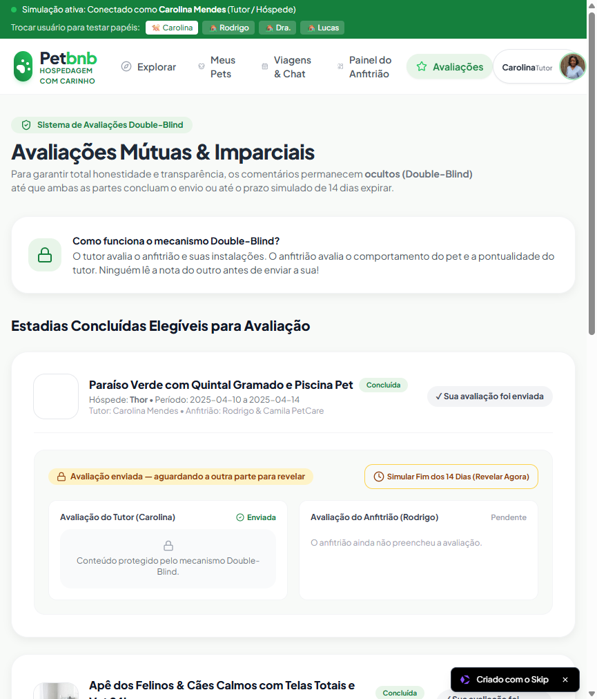

*Reviews tutor↔host com revelação apenas quando ambos enviam (ou simulação de timer).*

---

### Checklist de captura

| # | Arquivo | Rota | Status |
|---|---------|------|--------|
| 01 | `01-home.png` | `/` | Capturado |
| 02 | `02-listing-details.png` | `/listings/list-1` | Capturado |
| 03 | `03-pets-list.png` | `/pets` | Capturado |
| 04 | `04-new-pet.png` | `/pets/novo` | Capturado |
| 05 | `05-pet-details.png` | `/pets/pet-1` | Capturado |
| 06 | `06-checkout.png` | `/checkout/list-1` | Capturado |
| 07 | `07-host-dashboard.png` | `/host` | Capturado |
| 08 | `08-reservations-chat.png` | `/reservations` | Capturado |
| 09 | `09-reviews.png` | `/reviews` | Capturado |

> Capturas geradas com o app em execução (`vite` em `http://localhost:8081` — a porta 8080 estava ocupada no ambiente de captura). Recapture se a UI mudar.

---

## 7. Jornadas do usuário

### 7.1 Tutor

```
Explorar (/) → Detalhe listing → Checkout → Reserva criada
    → Viagens & Chat → Check-in/out → Avaliações
```

Paralelo: **Meus Pets** → novo pet (wizard) → perfil do pet usado no checkout.

### 7.2 Anfitrião

```
Painel (/host) → Aprovar/recusar pending → Bloquear datas
    → Durante estadia: diário + check-in/out
    → Avaliar pet/tutor (double-blind)
```

### 7.3 Regras de negócio já refletidas na UI

- **Instant Book** vs aprovação manual (critérios de vacina/rating do pet).
- Composição de preço: diária × noites + limpeza + % serviço + caução.
- Políticas: Flexível · Moderada · Rigorosa.
- Features pet: quintal, telas, piscina pet, câmeras, sem outros animais, vet próximo, etc.
- Status do listing: `active` | `paused`.

---

## 8. Funcionalidades: implementado vs simulado

### Implementado (UI + lógica em memória)

- Busca/filtro de listings  
- Detalhe com galeria, regras e preço  
- Cadastro multi-step de pet  
- Listar / ver / excluir pets  
- Checkout com seleção de pet e cartão mock  
- Fluxo Instant Book → `confirmed` ou `pending`  
- Host: aprovações, calendário, listings, receita mock  
- Chat por booking + auto-reply simulado  
- Diário de bordo, check-in e check-out  
- Reviews double-blind + simulação de revelação  
- Troca tutor/host via banner de simulação  

### Placeholders / não reais

| Item | Situação |
|------|----------|
| Auth / login | UI decorativa; sem sessão real |
| Pagamentos | Cartão validado localmente; sem gateway |
| Upload de arquivos | Nome de arquivo simulado |
| Persistência | Sem localStorage/API — refresh limpa estado |
| Admin | Sem rota ou fluxo |
| Mapas / geo | Ausente |
| Notificações e-mail/SMS/push | Ausente |
| Testes automatizados | Script `test` é stub |
| CI/CD e Docker | Ausentes |

---

## 9. Fases do projeto (roadmap)

### Fase 0 — Protótipo / demo *(atual)*

**Objetivo:** validar UX e storytelling do marketplace pet.

**Entregas**

- [x] SPA com 9 rotas principais  
- [x] Modelo de domínio tipado  
- [x] Simulação tutor ↔ host  
- [x] Fluxos de reserva, chat, diário e reviews na UI  

**Critério de aceite:** demo ao vivo cobrindo jornada tutor e host.

---

### Fase 1 — Fundação de produto

**Objetivo:** transformar o protótipo em base persistente e autenticada.

**Entregas**

- [ ] Auth real (e-mail e/ou OAuth) + sessão  
- [ ] Backend + Postgres (ex.: Supabase ou Neon) mapeando `types/index.ts`  
- [ ] Persistência de users, pets, listings, bookings, messages, reviews  
- [ ] Remoção do banner de simulação; papéis vindos do token/sessão  
- [ ] Variáveis por ambiente: `.env-dev`, `.env-homolog`, `.env-prod`  
- [ ] Autorização por papel (tutor / host; admin preparado)  

**Critério de aceite:** refresh mantém dados; login real; CRUD básico via API.

---

### Fase 2 — Marketplace operacional

**Objetivo:** operação diária sem mocks de mídia e disponibilidade.

**Entregas**

- [ ] CRUD completo de listings com storage de fotos  
- [ ] Calendário e disponibilidade no servidor  
- [ ] Instant Book e regras de elegibilidade no backend  
- [ ] Chat persistente (Realtime)  
- [ ] Upload real de carteira de vacinas e fotos do pet  
- [ ] Newsletter / e-mail transacional básico (opcional nesta fase)  

**Critério de aceite:** dois usuários reais concluem uma reserva ponta a ponta em homologação.

---

### Fase 3 — Pagamentos e confiança

**Objetivo:** monetização segura e governança.

**Entregas**

- [ ] Gateway (ex.: Stripe Connect) + caução  
- [ ] Webhooks, reembolsos e políticas de cancelamento efetivas  
- [ ] Verificação de hosts (`isHostVerified`)  
- [ ] Painel **admin** (moderação, disputas, denúncias)  
- [ ] Auditoria de eventos financeiros  

**Critério de aceite:** pagamento teste em sandbox; disputa resolvida no admin; caução liberada no check-out.

---

### Fase 4 — Escala e polish

**Objetivo:** crescimento, qualidade e canais adicionais.

**Entregas**

- [ ] Notificações (push / e-mail / SMS)  
- [ ] Busca geográfica e mapas  
- [ ] Revelação automática de reviews por timer em produção  
- [ ] Testes (unitários, integração, E2E das jornadas críticas)  
- [ ] Monitoramento, alertas e backups  
- [ ] PWA ou app mobile, se priorizado  

**Critério de aceite:** SLOs definidos; cobertura mínima de testes nas jornadas tutor/host; deploy automatizado.

---

### Visão consolidada das fases

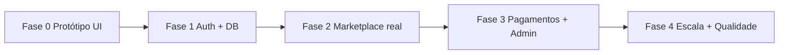

---

## 10. Implantação

### 10.1 Pré-requisitos

- Node.js 18+  
- pnpm (recomendado; o repo possui `pnpm-lock.yaml`)  
- Git  

### 10.2 Ambiente local (Fase 0)

```bash
# Na raiz do repositório
pnpm install
pnpm start
# Aplicação em http://localhost:8080
```

Scripts úteis:

| Script | Comando | Descrição |
|--------|---------|-----------|
| Dev | `pnpm start` ou `pnpm dev` | Servidor Vite |
| Build prod | `pnpm run build` | Saída em `dist/` |
| Build dev | `pnpm run build:dev` | Saída em `dev-dist/` |
| Preview | `pnpm run preview` | Serve a build localmente |
| Lint | `pnpm run lint` | Oxlint |
| Format | `pnpm run format` | Oxfmt |

> **Nota:** o `README.md` ainda menciona `localhost:5173`; a configuração real em `vite.config.ts` usa a porta **8080**.

### 10.3 Variáveis de ambiente

**Hoje (Fase 0):** nenhuma `VITE_*` obrigatória para rodar o front.

**A partir da Fase 1 (sugerido):**

| Variável | Ambiente | Uso |
|----------|----------|-----|
| `VITE_API_URL` / `DATABASE_URL` | todos | API ou connection string (servidor) |
| `VITE_SUPABASE_URL` | client | URL do projeto |
| `VITE_SUPABASE_ANON_KEY` | client | Chave pública |
| Secrets de service role / Stripe | **somente servidor** | Nunca no bundle do front |

Arquivos sugeridos (sem commitar segredos): `.env-dev`, `.env-homolog`, `.env-prod`.

### 10.4 Deploy do front atual (SPA estática)

1. `pnpm run build` → pasta `dist/`  
2. Publicar `dist/` em Vercel, Netlify, Cloudflare Pages, S3+CloudFront ou similar  
3. Configurar **SPA fallback**: todas as rotas → `index.html`  
4. Domínio customizado + HTTPS  
5. Smoke test: abrir `/`, `/host`, `/reservations`, deep link `/listings/list-1`  

Exemplo de ideia de config Vercel (`vercel.json` — a criar na Fase 0/1 de deploy):

```json
{
  "rewrites": [{ "source": "/(.*)", "destination": "/index.html" }]
}
```

### 10.5 Pipeline de implantação alvo (Fases 1–3)

1. Provisionar banco (Supabase/Neon) e migrations das entidades  
2. Configurar Auth + políticas RLS / autorização por papel  
3. Storage para fotos e carteiras de vacina  
4. API (REST/RPC/Edge Functions) alinhada ao `DataContext` atual  
5. Stripe (ou similar) + webhooks em homolog e produção  
6. CI: lint → typecheck → build → testes → deploy  
7. Deploy Homolog → smoke test das jornadas → Produção  
8. Monitoramento (erros, uptime) e backups do banco  

### 10.6 Checklist pós-deploy (Fase 0)

- [ ] Home carrega e lista anúncios mock  
- [ ] Detalhe de listing e checkout abrem sem 404  
- [ ] Troca de papel no banner funciona  
- [ ] Host consegue aprovar reserva pending  
- [ ] Chat e reviews renderizam  
- [ ] Build `dist/` serve corretamente com rewrite SPA  

---

## 11. Requisitos não funcionais

| Área | Diretriz |
|------|----------|
| **Segurança** | Validação de entrada (Zod), auth nas fases seguintes, HTTPS, sem secrets no client |
| **LGPD** | Minimizar dados sensíveis do pet/tutor; consentimento; exclusão sob demanda |
| **Performance** | CDN para assets; lazy load de imagens; code-splitting quando o bundle crescer |
| **Disponibilidade** | Health checks do API/DB a partir da Fase 1; status page opcional |
| **Manutenibilidade** | Páginas por domínio, types centralizados, UI Shadcn; arquivos > 300 linhas devem ser divididos |
| **Acessibilidade** | Componentes Radix; navegação por teclado; contraste adequado |

---

## 12. Riscos e mitigações

| Risco | Impacto | Mitigação |
|-------|---------|-----------|
| Protótipo sem persistência | Demo ≠ produto | Priorizar Fase 1 |
| Pagamento e caução | Financeiro / confiança | Stripe + webhooks + auditoria (Fase 3) |
| Confiança tutor ↔ host | Churn / incidentes | Verificação, reviews, admin, diário |
| Dados de saúde do pet | Privacidade | Minimização, consentimento, RLS |
| Drift doc ↔ código | Apresentação desatualizada | Atualizar screenshots e este MD a cada release de fase |

---

## 13. Anexos

### A. Rotas oficiais

| Rota | Página |
|------|--------|
| `/` | Index |
| `/pets` | PetsList |
| `/pets/novo` | NewPetForm |
| `/pets/:id` | PetDetails |
| `/listings/:id` | ListingDetails |
| `/checkout/:id` | Checkout |
| `/host` | HostDashboard |
| `/reservations` | ReservationsChat |
| `/reviews` | ReviewsPage |
| `*` | NotFound |

### B. IDs úteis do mock (demo)

| Tipo | IDs |
|------|-----|
| Users | `user-tutor-1`, `user-host-1`, `user-host-2`, `user-host-3` |
| Pets | `pet-1`, `pet-2`, `pet-3` |
| Listings | `list-1` … `list-6` |
| Bookings | `book-pending-1`, `book-confirmed-1`, `book-in-progress-1`, `book-completed-1`, `book-completed-2` |

### C. Manutenção da documentação (fonte única)

**Fonte de verdade:** `docs/PETSTAY-Documentacao.md`  
**Artefatos gerados:** `docs/PETSTAY-Apresentacao.html` (e opcionalmente `.pdf`)

```bash
# Após editar este Markdown:
pnpm docs:build          # regenera o HTML de apresentação
pnpm docs:pdf            # regenera HTML + PDF (Chrome/Edge headless)
pnpm docs                # alias de docs:pdf
```

Template visual: `docs/templates/apresentacao-shell.html` + `apresentacao.css`  
Script: `scripts/generate-docs.mjs`

**Exportar PDF pela UI:** abra `PETSTAY-Apresentacao.html` → botão **Exportar PDF** → Destino: Salvar como PDF → ative **Gráficos de segundo plano**.

**Compartilhar com a equipe:** pasta `docs/` (HTML + `screenshots/`) ou só o PDF.

### D. Glossário rápido

| Termo | Significado |
|-------|-------------|
| Instant Book | Reserva confirmada automaticamente se regras forem atendidas |
| Double-blind | Avaliações só reveladas após ambos enviarem (ou timer) |
| Caução | Valor retido e liberado no check-out se tudo ok |
| Daycare | Creche diurna (sem pernoite) |
| SuperHost | Flag de destaque do anfitrião no modelo |

---

## Análise de escalabilidade e manutenibilidade

Esta documentação separa o **estado atual (Fase 0)** do **caminho de produto (Fases 1–4)**. O Markdown é a **fonte única**; o HTML/PDF são regenerados com `pnpm docs:build` / `pnpm docs:pdf`, eliminando drift manual entre formatos. Screenshots em `docs/screenshots/` e o modelo em `src/types/index.ts` devem ser revisados a cada release de fase.

**Próximos passos:** (1) recapturar telas após mudanças visuais relevantes; (2) na Fase 1, anexar schema SQL e diagrama de sequência de reserva; (3) no CI, rodar `pnpm docs:build` e (opcional) Playwright para smoke das rotas + screenshots.

---

*Documento gerado para o projeto PETSTAY / Petbnb. Atualize a tabela de screenshots e o status das fases conforme o avanço do time.*
